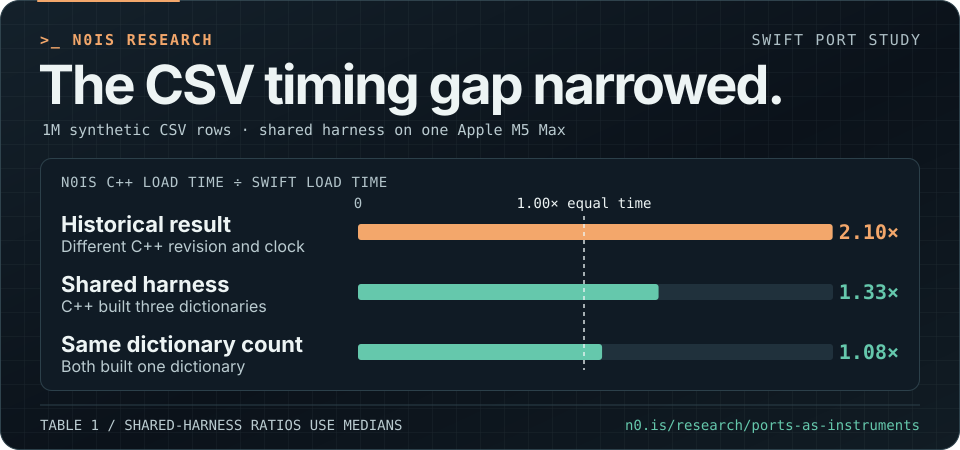

<!-- ASCII portrait drawn from Tyler's public DEV profile photo. https://dev.to/itylergarrett -->
<picture>
  <source media="(max-width: 640px)" srcset="assets/profile-mobile.svg">
  
</picture>

[dev3lop](https://dev3lop.com/) · [Client work](https://dev3lop.com/work/) · [Contact](https://t.j7.is/contact)

### Side project benchmarks

[n0is](https://n0.is/) · [Papers and rerun materials](https://n0.is/research/)

