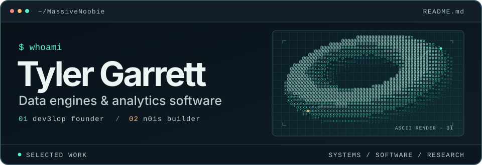
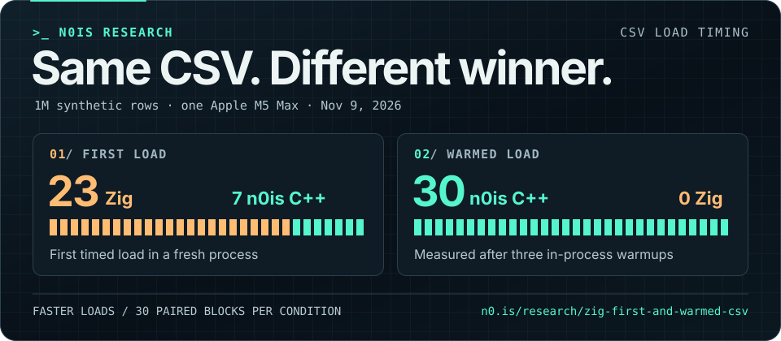

I’m Tyler Garrett. At [dev3lop](https://dev3lop.com/), I build data platforms and applications with client teams. I’m also building [n0is](https://n0.is/), a local-first analytics workspace powered by a C++ engine. I still sketch ideas on paper before I write code.

## Benchmarks

The [full study](https://n0.is/research/zig-first-and-warmed-csv/) covers both 1-million-row and 10-million-row inputs and explains how the paired timings were collected. A [separate study](https://n0.is/research/ports-as-instruments/) compared C++, Swift, Rust, Zig, and Go across 600 timed process runs on one M5 Max using synthetic CSV fixtures.

## Public work

| Project | What you can explore |
| --- | --- |
| [n0is Research](https://n0.is/research/) | Papers, benchmark methods, and materials to rerun the experiments |
| [ET1](https://et1s.netlify.app/) · [GitHub](https://github.com/MassiveNoobie/et1s) | A browser demo for building data workflows |
| [n0is Releases](https://github.com/MassiveNoobie/n0is-releases) | Public release metadata and checksums for model, voice, and Rug downloads |
| [dev3lop case study](https://dev3lop.com/work/exxonmobil/) | Real-time occupancy reporting and executive dashboards that supported 400+ people across 80+ campuses |

Away from the data work, I’m building a desktop music tool for sketching and editing MIDI arrangements.

[Contact me](https://t.j7.is/contact)
